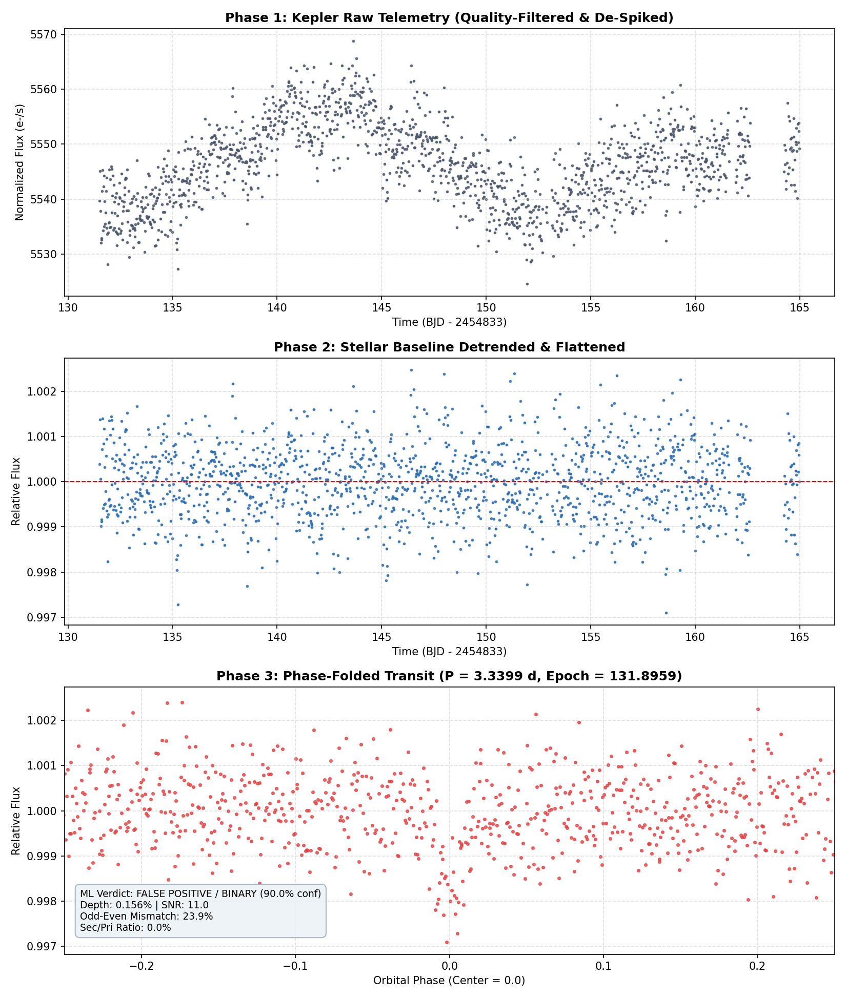

# 🪐 ExoPlanetTransit — Exoplanet Detection & Transit Analysis Platform

An end-to-end astrophysical data science pipeline and interactive web dashboard for detecting and validating exoplanetary transits in NASA Kepler light curve data.



---

## 🌟 Key Features

- **Automated Data Ingestion & Cleaning**:
  - Direct integration with NASA MAST archive using `astroquery`.
  - Handles null/NaN gaps and removes cosmic ray spikes via time-domain sigma clipping.
- **Detrending & Stellar Activity Filtering**:
  - Time-aware rolling median filter to remove low-frequency stellar variability and instrumental drifts.
  - Residual scatter and noise estimation (in parts-per-million, ppm).
- **Period Search via Box Least Squares (BLS)**:
  - Full Box Least Squares spectral periodogram scanning orbital periods from 0.5 to 20 days.
  - Automated extraction of best-fit transit duration, transit depth, and reference epoch ($T_0$).
- **Phase Folding**:
  - Folds high-cadence time series into normalized orbital phases to clearly display transit profiles.
- **Astrophysical Diagnostic Feature Extraction**:
  - Calculates primary transit depth, phase duration, baseline noise, transit SNR.
  - Computes secondary eclipse depth check, odd-even transit depth mismatches, and transit flatness ratio to distinguish planetary transits from eclipsing binary stars.
- **Machine Learning Classification**:
  - Pre-trained Random Forest classifier trained on confirmed Kepler planets vs. eclipsing binary false positives.
  - Computes real-time confidence scores and diagnostic metrics.
- **Interactive Web Dashboard**:
  - Built with Flask and modern CSS/JavaScript.
  - Interactive light curve charts, 3D/2D transit visualizer, live target downloader, and one-click end-to-end analysis.

---

## 🚀 Quickstart

### 1. Prerequisites & Installation

Ensure you have Python 3.9+ installed. Clone this repository and install dependencies:

```bash
git clone https://github.com/<your-username>/ExoPlanetTransit.git
cd ExoPlanetTransit
pip install -r requirements.txt
```

### 2. Launch the Web Dashboard

```bash
python app.py
```

Open your browser and navigate to:
```
http://127.0.0.1:5050
```

### 3. Command-Line Pipeline Runner

You can also run transit detection directly from the command line:

```bash
python pipeline_runner.py
```

To run unit tests on the data cleaning pipeline:
```bash
python test_pipeline.py
```

To download the benchmark Kepler catalogue:
```bash
python batch_downloader.py
```

To retrain or evaluate the Random Forest ML model:
```bash
python ml_pipeline.py
```

---

## 📁 Repository Structure

```
ExoPlanetTransit/
├── app.py                     # Flask web server and REST API endpoints
├── ingestion.py               # FITS loading, NaN cleaning, sigma clipping
├── detrending.py              # Stellar variability filter (rolling median)
├── period_search.py           # Box Least Squares (BLS) periodogram search
├── folding.py                 # Phase folding algorithm
├── feature_extraction.py      # Transit depth, SNR, odd-even mismatch, flatness
├── ml_pipeline.py             # Random Forest model training and cross-validation
├── pipeline_runner.py         # End-to-end CLI pipeline runner
├── batch_downloader.py        # Automated MAST batch downloader
├── test_pipeline.py           # Unit tests
├── requirements.txt           # Python dependencies
├── ml_dataset/
│   ├── exoplanet_rf_model.joblib   # Trained Random Forest classifier
│   ├── extracted_features.csv      # Extracted features dataset
│   └── labels.csv                  # Target labels & metadata
├── static/                    # Dashboard styles and scripts
│   ├── css/style.css
│   └── js/
│       ├── app.js
│       ├── charts.js
│       └── simulation.js
└── templates/
    └── index.html             # Dashboard UI template
```

---

## 🔬 Scientific Methodology

1. **Light Curve Cleansing**: Identifies invalid cadences and flags out-of-range cosmic ray artifacts with moving window sigma clipping.
2. **Stellar Detrending**: Removes low-frequency stellar pulsations using rolling median smoothing without warping transit ingress and egress slopes.
3. **BLS Period Finding**: Evaluates periodic box-like dips across a continuous grid of trial periods using `astropy.timeseries.BoxLeastSquares`.
4. **Vetting & Classification**: Distinguishes true planetary candidates from eclipsing binary false positives via depth comparisons, odd/even orbit consistency, and secondary eclipse tests.

---

## 📜 License

MIT License. Open source and free for scientific, educational, and research use.
